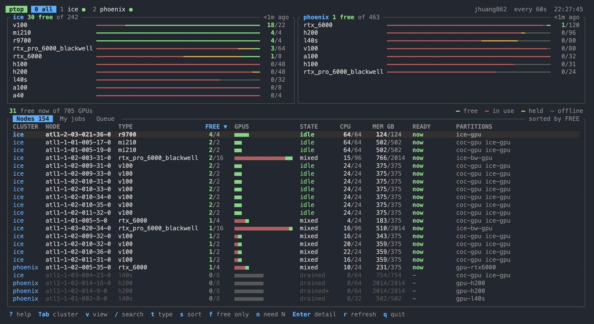
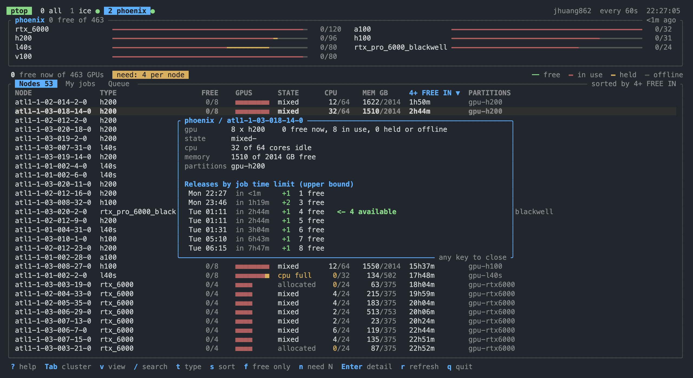
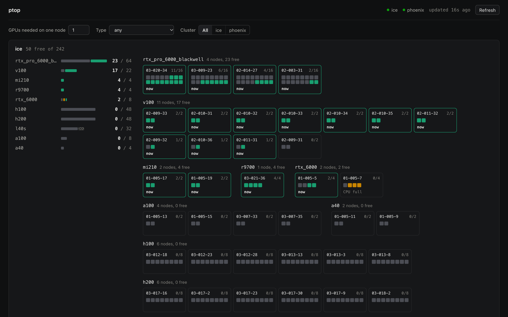

# ptop

Find a free GPU on a Slurm cluster without squinting at `sinfo`. Built for Georgia Tech PACE (ICE, Phoenix); works on any Slurm cluster and on standalone `nvidia-smi` servers.

Read-only: it runs `sinfo`, `squeue` or `nvidia-smi` over ssh. It submits nothing and installs nothing on the cluster.



## Install

```bash
cargo install --git https://github.com/zilongpa/ptop
ptop init -u <user>   # write the config file
ptop
```

Or skip the file and run `ptop -u <user>`; `-u` also overrides the user in the config.

ptop needs ssh access to each login node, by key or by password (see [Config](#config)). With no clusters configured it watches PACE ICE and Phoenix.

## Reading the screen

| Color | Meaning |
|---|---|
| green | free: a new job can get it now |
| red | in use |
| amber | held: idle, but the node is reserved by backfill or out of CPU / memory |
| gray | offline |

The READY column says when a node can take your job: `now`, a wait such as `2h31m` (from other jobs' time limits, so an upper bound), or `?` where the cluster hides other users' jobs.

Press `n` and enter how many GPUs you need on one node. Smaller nodes disappear and the table sorts by how soon that many are free. `Enter` shows the release schedule.



## Keys

| Key | Action |
|---|---|
| `Tab` `0-9` | switch cluster |
| `v` | switch view: nodes, my jobs, queue |
| `/` | search |
| `t` / `T` | cycle the GPU type filter / clear it |
| `s` / `I` | next sort column / reverse |
| `f` | only nodes with a free GPU |
| `n` | GPUs needed on one node |
| `Enter` | node detail |
| `r` | poll now |
| `e` | full ssh error text of failing clusters |
| `?` | help |
| `q` | quit |

## Config

```bash
ptop init -u <user>   # writes a commented starter file and prints its path
```

The file is `~/.config/ptop/config.toml` on Linux and macOS, `%APPDATA%\ptop\config.toml` on Windows:

```toml
user = "gburdell3"
interval = 60                           # seconds between polls
ssh_args = ["-i", "~/.ssh/cluster_key"] # extra arguments for every ssh call

[[cluster]]
name = "ice"
host = "login-ice.pace.gatech.edu"

[[cluster]]
name = "lab"
host = "gpu-box.example.edu"
user = "someone"                        # if it differs from the global user
partitions = ["gpu-a", "gpu-b"]         # skip partition discovery
password_command = "pass show lab"      # for hosts that only accept a password
```

With no `[[cluster]]` at all, ptop watches PACE ICE and Phoenix. A host is probed on first contact: with `sinfo` it is a Slurm cluster and the GPU partitions you can submit to are discovered from your groups, accounts and QOS; with only `nvidia-smi` it is shown as one standalone node, where a GPU counts as in use when it has a compute process, more than 1 GB of memory in use, or more than 10% utilization.

### Password logins

Keys or an ssh agent are the default and need no setup. For a host that only takes a password, give the cluster one of:

- `password_command`: a shell command that prints the password, such as a keychain or password-manager lookup. Preferred.
- `password`: the password itself. ptop refuses to start if the file is then readable by other users (`chmod 600`).

ptop hands the password to ssh through the `SSH_ASKPASS` mechanism, which needs OpenSSH 8.4 or newer. Connect to the host once by hand first so its host key is known; ptop never accepts a new host key for you. Hosts that also ask for a second factor are not supported.

### Windows

ptop uses the `ssh.exe` that ships with Windows 10 and 11 (Settings, Optional features, OpenSSH Client). Run it in Windows Terminal for the box-drawing characters.

## Web UI

`ptop webui` serves the same data as a web page, with every node laid out as a tile.

```bash
ptop webui                     # http://127.0.0.1:8787
ptop webui --bind 0.0.0.0:8787 # share it on your network
```


